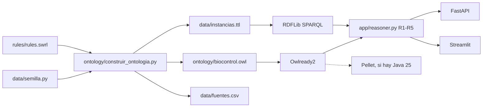

# Sistema experto de biocontrol — AgroTech UCaldas

Prototipo académico para consultar qué enemigo natural está documentado frente a una plaga de cítricos, bajo qué ventana de uso, con qué nivel de evidencia y con qué fuente. No es una prescripción agronómica.

El inventario F01–F17 vive en `data/inventario_fuentes.tex` y se carga desde `data/semilla.py`. Una fuente puede ser de confiabilidad alta y, aun así, no traer una ventana de liberación: en ese caso la relación se conserva y el número no se inventa.

## Qué responde

| Pregunta | Dónde vive la respuesta |
| --- | --- |
| ¿Qué enemigos naturales están documentados para *D. citri*? | *Tamarixia radiata*, *Diaphorencyrtus* sp., *Hirsutella citriformis* y *Beauveria bassiana* (cepas mexicanas, F11) |
| ¿Qué nivel de evidencia respalda cada relación? | Alta en las de laboratorio o campo citadas; Media en *Diaphorencyrtus*, porque F01 prueba presencia y el control queda como hipótesis |
| ¿Existen restricciones documentadas? | Insecticidas botánicos (F10) y extractos vegetales (F06) sobre *Tamarixia*. El caldo sulfocálcico (F05) no entra a R4: la ficha pide verificar antes su efecto sobre enemigos naturales |
| ¿Qué pasa si la plaga no tiene agente en la base? | Las tres plagas del inventario sí tienen agente. Un nombre que no está registrado devuelve `Evidencia insuficiente` y activa R3 |
| ¿Qué conexión hay con ClayOMICS y MAGNETIME? | MAGNETIME: tomate y soja (F13–F15). ClayOMICS: noticia institucional (F16) y revisión de xenometabolómica (F17), que no es un resultado del spin-off |

En el ejemplo (25 °C, cualquier humedad, sin una práctica conflictiva) la conclusión es **AltamenteRecomendado**, agente **Tamarixia radiata**, evidencia **Alta**, fuente **F02 - Restrepo-García et al. (2016)**. La ventana que decide es **15–35 °C** (tabla de vida de Gómez-Torres et al., 2012, F08; mayor viabilidad a 25 °C). La humedad 70 ± 10 % es la condición de ese ensayo, no un umbral de liberación.

## Arquitectura



La relación de biocontrol está reificada: no basta el enlace directo «la plaga es controlada por el agente». La ventana, la evidencia, las restricciones y la fuente cuelgan de `RelacionBiocontrol`, que es la clase central.

Las cinco reglas:

- **R1 Aplicabilidad.** Evidencia Alta y temperatura dentro de una ventana documentada → `AltamenteRecomendado`. La humedad solo filtra si la ficha la marca como umbral. Hoy ninguna lo está.
- **R2 Precaución.** La misma ventana, con evidencia Media o Baja → `PotencialmenteRecomendado` y una nota de precaución. Sin ventana, R2 no dispara.
- **R3 Laguna.** La plaga no está en la base, o está y no tiene agente. OWL es de mundo abierto y no puede concluir «no existe», así que el prototipo cierra el mundo de dos formas: la consulta SPARQL usa `FILTER NOT EXISTS`, y el OWL marca esas plagas como `PlagaSinAgenteDocumentado` para que la regla SWRL pueda disparar. En el inventario actual esa clase queda vacía.
- **R4 Incompatibilidad.** Si una práctica declarada coincide con una restricción, la relación queda advertida. La evidencia no se borra.
- **R5 Trazabilidad.** Toda conclusión cita la relación y su fuente principal. Si el hecho está documentado pero no hay ventana, la respuesta es `Documentado sin ventana de uso` y solo se activa R5.

Si hay varias relaciones aplicables, gana la de mayor nivel. Una restricción activa resta un punto de prioridad. El empate lo resuelve la ventana más estrecha.

La única ventana numérica de decisión es 15–35 °C para *Tamarixia radiata* (F08). F09 estudia promedios de 12 a 38 °C y se cita como complemento, no como umbral de liberación. *Hirsutella citriformis* (F07) tiene 98 % de mortalidad en laboratorio y no trae rango agroclimático: la incubación publicada como 25 ± 20 °C no se convierte en ventana. *Beauveria bassiana* (F11) tampoco; las cepas son mexicanas y no hay una cepa «UC10» en el inventario. *Chrysoperla carnea* (F12) se documenta contra *Phyllocoptruta oleivora* en naranja Valencia, no contra *D. citri*.

ClayOMICS y MAGNETIME no miden biocontrol de cítricos en este inventario. MAGNETIME queda articulado a los experimentos de semilla de tomate y soja. ClayOMICS queda como contexto institucional más la revisión analítica del grupo de Cromatografía.

## Instalación

Hace falta Python 3.12. En este equipo el `python` por defecto puede ser 3.14; Owlready2 se probó con 3.12.

```bash
py -3.12 -m venv .venv
source .venv/Scripts/activate
pip install -r requirements.txt
python -m ontology.construir_ontologia
```

En macOS o Linux el entorno se activa con `source .venv/bin/activate`.

## Uso

Dos terminales, ambas en la raíz del proyecto:

```bash
uvicorn app.main:app --reload
```

```bash
streamlit run app/ui.py
```

- API: <http://127.0.0.1:8000/docs>
- Interfaz: <http://127.0.0.1:8501>

La interfaz no necesita la API encendida: las dos entran al mismo motor. La pantalla de consulta tiene tres zonas: entrada (plaga, temperatura, humedad y prácticas), tarjeta de resultado y árbol de reglas. El azul `#0D336E` es el color institucional usado en la cabecera. El pie repite que esto no es una prescripción.

Ejemplo de consulta:

```bash
curl -X POST http://127.0.0.1:8000/consultar \
  -H "Content-Type: application/json" \
  -d "{\"plaga\":\"Diaphorina_citri\",\"temperatura\":25,\"humedad\":70}"
```

Otros caminos útiles para la sustentación:

| Consulta | Qué debe pasar |
| --- | --- |
| *D. citri*, 25 °C, cualquier humedad | R1 y R5. Tamarixia, evidencia Alta, fuente F02. Ventana 15–35 °C |
| *D. citri*, 15 °C o 35 °C | Sigue R1. Los bordes de F08 entran. 12 °C queda fuera |
| *D. citri*, 25 °C, práctica `aplicacion_insecticida_botanico` | R1, R4 y R5. Sigue Tamarixia, con la mortalidad de F10 |
| *D. citri*, práctica `aplicacion_extractos_vegetales` | Igual: R4 avisa la interacción de F06. Los valores por extracto no están en la ficha |
| *Compsus sp.* o el ácaro tostador | Documentado sin ventana de uso. *Trigonospila unicaldasi* (F04) o *Chrysoperla carnea* (F12). No es R3 |
| Un nombre que no está en la base | «La plaga consultada no está registrada en la base actual. Se activa R3: laguna de conocimiento.» |
| *D. citri* a 12 °C | Condiciones no satisfechas. Los agentes existen; la ventana de Tamarixia no cubre esa temperatura |

Las cinco preguntas también están en la pestaña **Preguntas de competencia** y en `GET /competencia`.

## Razonador

Las reglas están escritas en sintaxis SWRL en `rules/rules.swrl` (`swrlb:greaterThanOrEqual` y `swrlb:lessThanOrEqual` comparan la temperatura documentada). El constructor las inserta en el OWL: quedan siete implicaciones, porque R2 y R5 no tienen disyunción en el antecedente y se parten en dos.

Cada clic se explica en Python (`app/reasoner.py`). Pellet aplica reglas, pero no devuelve el árbol «esta regla sí, esta no». Además, el Pellet que trae Owlready2 0.51 está compilado para **Java 25**. En este equipo hay Java 17, así que Pellet no arranca y el prototipo responde igual con el motor Python. `GET /health` lo deja dicho. Con Java 25, `python -c "from app.reasoner import probar_pellet; print(probar_pellet())"` debe marcar `r1_tamarixia` y `r3_sin_laguna_en_la_semilla`.

## Cómo extender la ontología

1. Editar `data/semilla.py` (plaga, agente, condición, fuente, restricción o relación).
2. Regenerar:

```bash
python -m ontology.construir_ontologia
```

3. Reiniciar uvicorn y Streamlit.

Ese comando reescribe `ontology/biocontrol.owl`, `data/instancias.ttl` y `data/fuentes.csv`. No edite esos tres a mano: el siguiente regenerado los pisa.

Para una regla nueva: agregarla en `rules/rules.swrl`, reflejarla en `app/reasoner.py` (si no, la interfaz no la puede explicar) y cubrirla con una prueba en `tests/`.

`ontology/shacl_shapes.ttl` exige que toda relación tenga plaga, agente, fuente principal, al menos un respaldo y un nivel dentro de Alta, Media, Baja o Insuficiente. La condición de uso y la humedad son opcionales.

## Pruebas

```bash
python -m pytest -q
```

Cubren la carga de la ontología, SHACL, las cinco preguntas de competencia, los casos R1–R5, la API y una pasada de la interfaz Streamlit (el botón Consultar, sin navegador gráfico).

## Docker

```bash
docker compose up --build
```

La API queda en el puerto 8000 y la interfaz en el 8501. La imagen no incluye Java.

## Límites

- El nivel de la relación no es el mismo que el de la fuente. F01 es de confiabilidad alta y, aun así, la relación de control de *Diaphorencyrtus* queda en Media porque el efecto no se midió.
- R3 habla de lo que **esta base** no registra. En el inventario actual las tres plagas tienen agente; la laguna aparece al consultar un nombre que no está.
- F08 y F11 son ensayos de laboratorio fuera de Caldas. No autorizan una dosis de campo ni una cepa local.
- MAGNETIME y ClayOMICS no aportan una medición de biocontrol en cítricos. F13 es, en el propio inventario, la evidencia que falta para el caso integrador.
