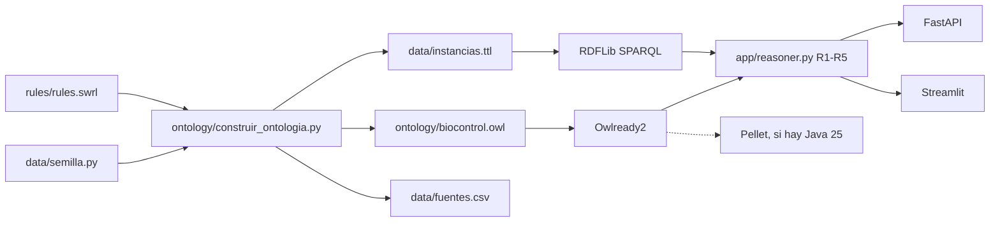

# Sistema experto de biocontrol — AgroTech UCaldas

Prototipo académico para consultar qué enemigo natural está documentado frente a una plaga de cítricos, bajo qué ventana de temperatura y humedad, con qué nivel de evidencia y con qué fuente. No es una prescripción agronómica.

La carpeta del curso no traía el informe LaTeX, así que el inventario F01–F17 se armó con publicaciones y notas institucionales verificables (Universidad de Caldas, Caldasia, Journal of Fungi, Florida Entomologist, AgroSavia, ICA). Si el informe numera las fuentes de otra manera, el cambio se hace en `data/semilla.py` y se regenera la ontología.

## Qué responde

| Pregunta | Dónde vive la respuesta |
| --- | --- |
| ¿Qué enemigos naturales están documentados para *D. citri*? | *Tamarixia radiata*, *Diaphorencyrtus aligarhensis* y *Hirsutella citriformis* |
| ¿Qué nivel de evidencia respalda cada relación? | Alta para Tamarixia; Media para Diaphorencyrtus y Hirsutella |
| ¿Existen restricciones documentadas? | Piretroides y neonicotinoides para los parasitoides; cobre y azufre para el hongo |
| ¿Qué pasa si la plaga no tiene agente en la base? | `Evidencia insuficiente` y se activa R3 |
| ¿Qué conexión hay con ClayOMICS y MAGNETIME? | Enlaces de interoperabilidad con estado **propuesto**, no mediciones hechas |

En la ventana de ejemplo (25 °C y 70 % de humedad, sin una práctica conflictiva) la conclusión es **AltamenteRecomendado**, agente **Tamarixia radiata**, evidencia **Alta**, fuente **F02 - Restrepo-García et al. (2016)**.

## Arquitectura



La relación de biocontrol está reificada: no basta el enlace directo «la plaga es controlada por el agente». La ventana, la evidencia, las restricciones y la fuente cuelgan de `RelacionBiocontrol`, que es la clase central.

Las cinco reglas:

- **R1 Aplicabilidad.** Evidencia Alta y clima dentro de la ventana → `AltamenteRecomendado`.
- **R2 Precaución.** La misma ventana con evidencia Media o Baja → `PotencialmenteRecomendado` y una nota de precaución.
- **R3 Laguna.** La plaga afecta un cultivo y la base no tiene agente. OWL es de mundo abierto y no puede concluir «no existe», así que el prototipo cierra el mundo de dos formas: la consulta SPARQL usa `FILTER NOT EXISTS`, y el OWL marca esas plagas como `PlagaSinAgenteDocumentado` para que la regla SWRL pueda disparar.
- **R4 Incompatibilidad.** Si una práctica declarada coincide con una restricción, la relación queda advertida. La evidencia no se borra.
- **R5 Trazabilidad.** Toda conclusión cita la relación y su fuente principal.

Si hay varias relaciones aplicables, gana la de mayor nivel. Una restricción activa resta un punto de prioridad. El empate lo resuelve la ventana más estrecha.

Las ventanas numéricas son parámetros operativos del prototipo, anclados en las fuentes (por ejemplo McFarland y Hoy, 2001, para los parasitoides, y Pérez-González et al., 2022, para *Hirsutella*). No son la tabla de un único experimento ni una dosis de campo.

ClayOMICS (análisis de datos químicos) y MAGNETIME (magnetobiología) son emprendimientos de la Universidad de Caldas. En el grafo se articulan con un análisis de exudados y con una pregunta experimental sobre conidios. El estado del enlace es `propuesto`: el sistema no afirma que esas plataformas hayan medido la cepa.

## Instalación

Hace falta Python 3.12. En este equipo el `python` por defecto puede ser 3.14; Owlready2 se probó con 3.12.

```bash
py -3.12 -m venv .venv
source .venv/Scripts/activate
pip install -r requirements.txt
python -m ontology.construir_ontologia
```

En macOS o Linux el entorno se activa con `source .venv/bin/activate`.

## Uso

Dos terminales, ambas en la raíz del proyecto:

```bash
uvicorn app.main:app --reload
```

```bash
streamlit run app/ui.py
```

- API: <http://127.0.0.1:8000/docs>
- Interfaz: <http://127.0.0.1:8501>

La interfaz no necesita la API encendida: las dos entran al mismo motor. La pantalla de consulta tiene tres zonas: entrada (plaga, temperatura, humedad y prácticas), tarjeta de resultado y árbol de reglas. El azul `#0D336E` es el color institucional usado en la cabecera. El pie repite que esto no es una prescripción.

Ejemplo de consulta:

```bash
curl -X POST http://127.0.0.1:8000/consultar \
  -H "Content-Type: application/json" \
  -d "{\"plaga\":\"Diaphorina_citri\",\"temperatura\":25,\"humedad\":70}"
```

Otros caminos útiles para la sustentación:

| Consulta | Qué debe pasar |
| --- | --- |
| *D. citri*, 25 °C, 70 % | R1 y R5. Tamarixia, evidencia Alta, fuente F02 |
| *D. citri*, 26 °C, 90 % | R2 y R5. *Hirsutella*, evidencia Media |
| *D. citri*, 25 °C, 70 %, práctica `aplicacion_piretroide` | R1, R4 y R5. Sigue Tamarixia, con advertencia |
| *D. citri*, 26 °C, 90 %, práctica `aplicacion_fungicida_cuprico` | Se prefiere Diaphorencyrtus; el hongo queda restringido |
| *Compsus sp.* o el ácaro tostador | R3. Evidencia insuficiente |
| Un nombre que no está en la base | «La plaga consultada no está registrada en la base actual. Se activa R3: laguna de conocimiento.» |
| *D. citri* a 12 °C | Condiciones no satisfechas. No es una laguna: los agentes existen, la ventana no |

Las cinco preguntas también están en la pestaña **Preguntas de competencia** y en `GET /competencia`.

## Razonador

Las reglas están escritas en sintaxis SWRL en `rules/rules.swrl` (`swrlb:greaterThanOrEqual` y `swrlb:lessThanOrEqual` comparan la temperatura y la humedad de la consulta). El constructor las inserta en el OWL: hoy quedan siete implicaciones, porque R2 y R5 no tienen disyunción en el antecedente y se parten en dos.

Cada clic se explica en Python (`app/reasoner.py`). Pellet aplica reglas, pero no devuelve el árbol «esta regla sí, esta no». Además, el Pellet que trae Owlready2 0.51 está compilado para **Java 25**. En este equipo hay Java 17, así que Pellet no arranca y el prototipo responde igual con el motor Python. `GET /health` lo deja dicho. Con Java 25, `python -c "from app.reasoner import probar_pellet; print(probar_pellet())"` debe marcar `r1_tamarixia` y `r3_compsus`.

## Cómo extender la ontología

1. Editar `data/semilla.py` (plaga, agente, condición, fuente, restricción o relación).
2. Regenerar:

```bash
python -m ontology.construir_ontologia
```

3. Reiniciar uvicorn y Streamlit.

Ese comando reescribe `ontology/biocontrol.owl`, `data/instancias.ttl` y `data/fuentes.csv`. No edite esos tres a mano: el siguiente regenerado los pisa.

Para una regla nueva: agregarla en `rules/rules.swrl`, reflejarla en `app/reasoner.py` (si no, la interfaz no la puede explicar) y cubrirla con una prueba en `tests/`.

`ontology/shacl_shapes.ttl` exige que toda relación tenga plaga, agente, condición, fuente principal, al menos un respaldo y un nivel dentro de Alta, Media, Baja o Insuficiente.

## Pruebas

```bash
python -m pytest -q
```

Cubren la carga de la ontología, SHACL, las cinco preguntas de competencia, los casos R1–R5, la API y una pasada de la interfaz Streamlit (el botón Consultar, sin navegador gráfico).

## Docker

```bash
docker compose up --build
```

La API queda en el puerto 8000 y la interfaz en el 8501. La imagen no incluye Java.

## Límites

- El nivel de evidencia es una clasificación de este inventario, no un metaanálisis.
- R3 habla de lo que **esta base** no documenta. *Compsus* y *Phyllocoptruta oleivora* no tienen agente aquí; eso no prueba que no existan enemigos en la literatura.
- Los enlaces con ClayOMICS y MAGNETIME son una propuesta de interoperabilidad entre proyectos de la Universidad de Caldas.
